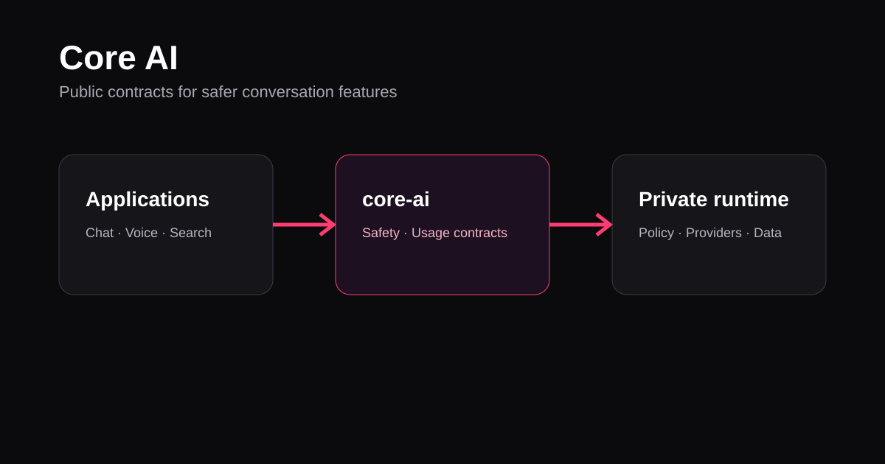

# Core AI



Core AI is a small TypeScript package for provider-neutral conversation safety and metered-usage contracts. It is designed to be used by web apps, workers, and voice services without exposing production prompts, customer data, or provider credentials.

## What it provides

- Input isolation for user-supplied text before it enters a prompt data field.
- A typed authorization boundary for metered chat, voice, and embedding requests.
- No provider SDKs, credentials, or tenant data.

## Framework

- TypeScript 5
- ECMAScript modules
- Node.js 20 or later

## Use

```ts
import { isolateUntrustedText, requireUsageAuthorization } from "@mdcran/core-ai";

const safeNote = isolateUntrustedText(visitorMessage);
await requireUsageAuthorization(policy, { channel: "chat", operation: "reply", subjects: [] });
```

## Development

```bash
npm install
npm run check
npm run build
```

## Ownership

Built and maintained by [MDCran](https://github.com/MDCran).
